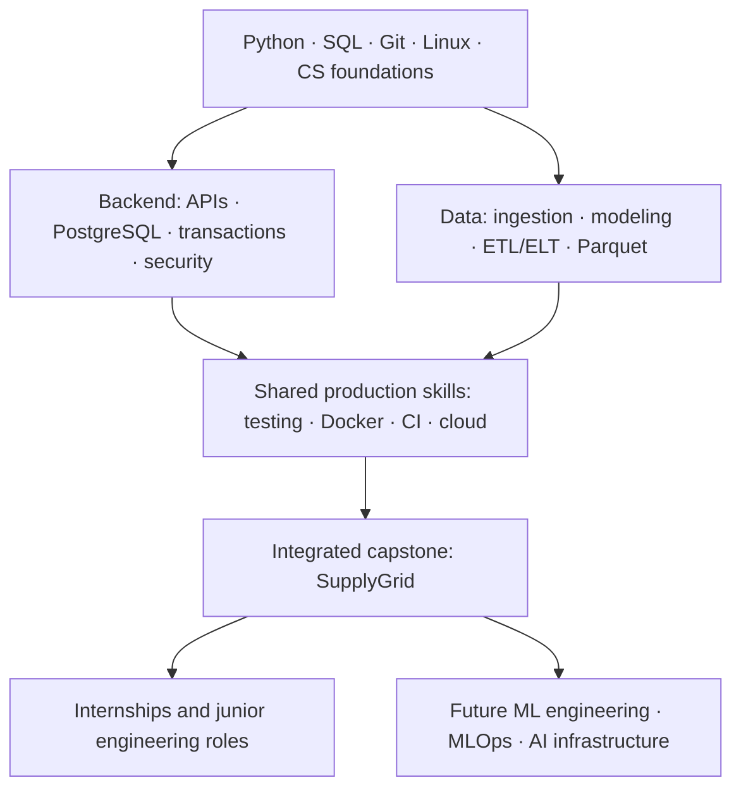
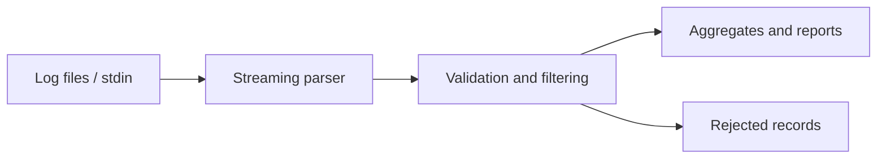
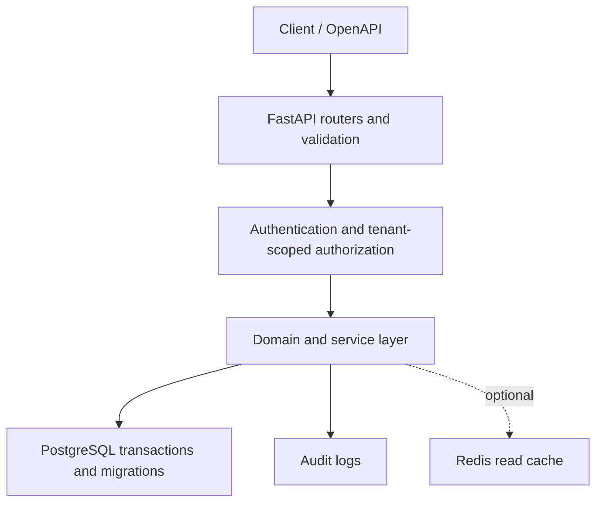
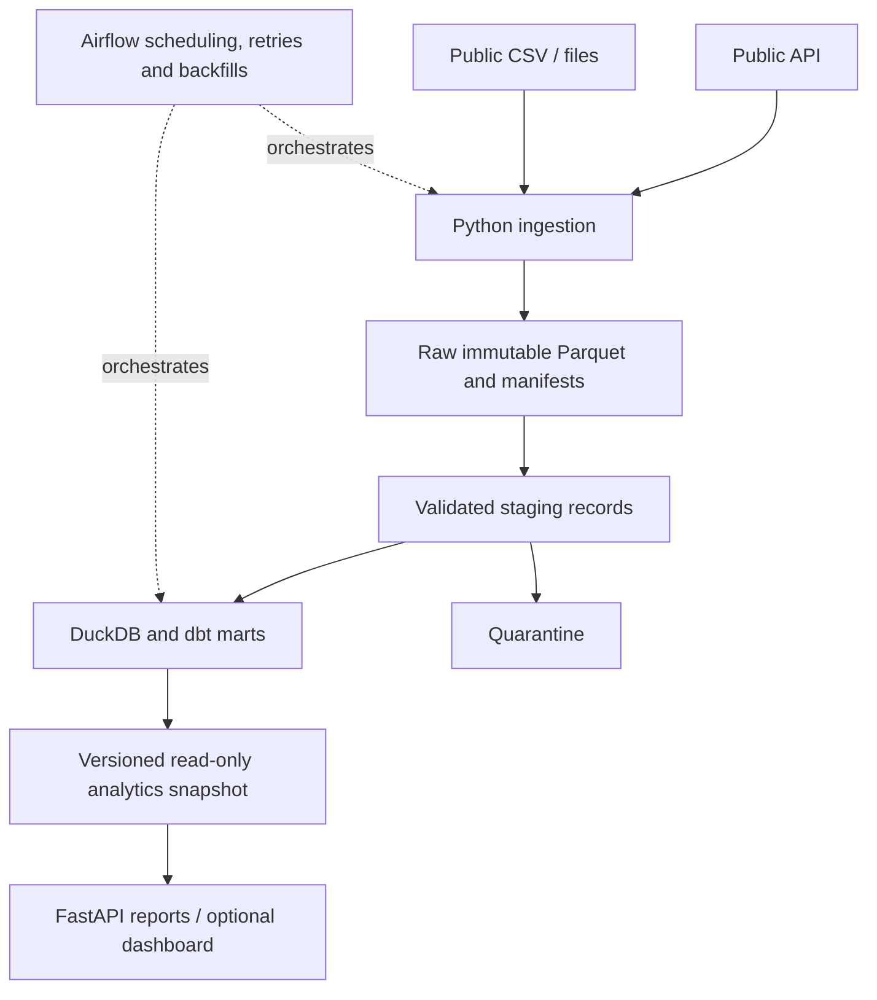
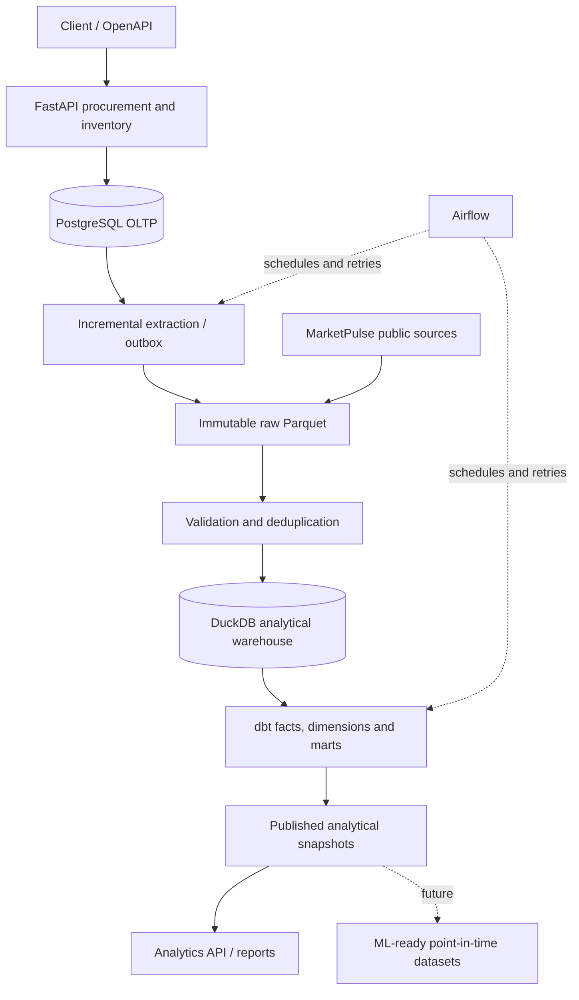

<div align="center">

# Backend & Data Engineering

### A free, self-directed engineering curriculum

**From programming foundations to reliable backend services and data platforms.**


[Curriculum](#curriculum) · [Weekly schedule](#weekly-schedule) · [Portfolio projects](#portfolio-projects) · [Graduation](#graduation-requirements) · [ML pathway](#machine-learning-pathway)

</div>

---

## About

An independent, OSSU-inspired study program for a Computer Science student who wants to pursue backend software engineering and data engineering simultaneously, become competitive for internships and junior roles within one year, and eventually specialize in machine learning engineering, MLOps, or AI infrastructure.

This is **not an accredited degree**, an official OSSU program, or a guarantee of employment. It complements a CS degree rather than replacing it. The curriculum emphasizes building, testing, operating, and explaining systems instead of collecting certificates or copying tutorials.

**Version:** 1.0 — November 2026  
**Research basis:** Deep Research review dated November 24, 2026, plus subsequent portfolio and scheduling refinements. Provider links from that review are retained; supplementary references are not newly live-verified. Course editions, registration terms and job listings may change.

## Table of contents

- [Program structure](#program-structure)
- [How to study](#how-to-study)
- [Curriculum](#curriculum)
  - [Core foundations](#core-foundations)
  - [Core backend engineering](#core-backend-engineering)
  - [Core data engineering](#core-data-engineering)
  - [Core production engineering](#core-production-engineering)
  - [Advanced electives](#advanced-electives)
- [Weekly schedule](#weekly-schedule)
- [Portfolio projects](#portfolio-projects)
  - [P1 — LogForge](#p1--logforge)
  - [P2 — QueryBench](#p2--querybench)
  - [P3 — LedgerFlow](#p3--ledgerflow)
  - [P4 — MarketPulse](#p4--marketpulse)
  - [P5 — SupplyGrid](#p5--supplygrid)
- [Engineering standards](#engineering-standards)
- [Interview and employment preparation](#interview-and-employment-preparation)
- [Graduation requirements](#graduation-requirements)
- [Machine learning pathway](#machine-learning-pathway)
- [Research and references](#research-and-references)
- [Repository organization](#repository-organization)

## Program structure

| Property | Plan |
| --- | --- |
| Duration | 52 weeks / 12 months |
| Weekly study | 18 hours outside college |
| Total planned study | 936 hours |
| Required tuition | ₱0 for core learning materials; internet/electricity excluded |
| Primary languages | Python and SQL |
| Secondary language | Java (optional elective) |
| Portfolio | 2 foundations projects + 2 flagship projects + 1 integrated capstone |
| Applications | Backend internships around week 24; data internships around week 32 |
| Target roles | Backend/software intern, junior Python/backend developer, data engineering intern, junior ETL/data engineer |

### Learning progression



| Term | Weeks | Focus | Milestones |
| --- | --- | --- | --- |
| I | 1–13 | Shared foundations, early backend and data labs | LogForge + QueryBench |
| II | 14–26 | Backend depth, batch ingestion and data modeling | LedgerFlow v1.0 |
| III | 27–39 | Data platform depth, backend integration and operations | MarketPulse v1.0 |
| IV | 40–52 | Cloud, reliability, capstone, interviews | SupplyGrid v1.0 |

### Annual workload

These are mutually exclusive time categories, not extra homework on top of the weekly schedule.

| Activity | Hours |
| --- | ---: |
| Courses, readings and guided technical labs | 456 |
| Independent portfolio engineering | 350 |
| Interview and deliberate SQL/DSA practice | 80 |
| Applications, reviews, demos and professional development | 50 |
| **Total** | **936** |

Course allocations below are **selected-study budgets**, not official provider course durations. Some courses are intentionally sampled. Full completion and certificates may require extra time. The weekly timetable is the controlling schedule; do not count the same lab as both course work and portfolio work.

### Technology stack

| Layer | Core | Later / optional |
| --- | --- | --- |
| Programming | Python, SQL, Bash | Java, Go |
| Backend | FastAPI, Pydantic, SQLAlchemy, Alembic | Spring Boot, Django |
| Databases | PostgreSQL, DuckDB | Redis caching (small lab), other NoSQL |
| Data processing | pandas, PyArrow, Parquet | PySpark, Kafka |
| Data modeling | dimensional modeling, dbt Core with DuckDB | lakehouse formats |
| Orchestration | Apache Airflow | Kestra (Zoomcamp exposure) |
| Testing | pytest, SQL/dbt tests, API integration tests | Locust load testing extensions |
| Delivery | Git, GitHub Actions, Docker Compose | Kubernetes |
| Cloud and IaC | AWS fundamentals, AWS Educate, local Terraform | production AWS/GCP, managed services |

## How to study

### Weekly routine

| Day | Focus | Hours |
| --- | --- | ---: |
| Monday | Backend / shared programming | 3 |
| Tuesday | Data engineering / SQL | 3 |
| Wednesday | Algorithms or CS theory | 1 |
| Thursday | Backend / production labs | 3 |
| Friday | Data engineering / production labs | 3 |
| Saturday | Independent portfolio project | 4 |
| Sunday | Review and career preparation | 1 |
| **Total** | | **18** |

Shift these hours around college deadlines. During exams, reduce pace instead of sacrificing sleep; resume with the next incomplete week. Early weeks emphasize foundations; later weeks emphasize one track without dropping the other. Every major project is cumulative.

### Study rules

1. Complete lectures **and** exercises. Watching videos alone does not count.
2. Attempt problems independently; use documentation before AI. Use AI for hints, code review, debugging explanations and test ideas.
3. Do one 90-minute AI-free session weekly, two during interview preparation.
4. Follow each course's academic honesty policy. Keep restricted assignments and solutions private; publish original projects and permissible notes instead.
5. Record actual hours, Git commits, test results and mistakes. Check a week off only after meeting its acceptance criteria.
6. Use local services by default. Do not enter a credit card or activate a paid cloud trial merely to follow a tutorial. Use free AWS Educate labs or local equivalents.
7. Pin compatible dependencies and document versions. Older video tutorials may require modern FastAPI, Pydantic, SQLAlchemy and authentication syntax.
8. If behind, remove optional Kafka, Spark, Java or cloud extensions before cutting tests, security or the core projects.

### Setup checklist

- [ ] Install [WSL2](https://learn.microsoft.com/en-us/windows/wsl/install) or use native Linux.
- [ ] Install a supported Python version compatible with your course tools; create virtual environments.
- [ ] Install Git, configure SSH or HTTPS authentication, and create a GitHub account.
- [ ] Install VS Code or an equivalent editor; learn terminal-based execution.
- [ ] Install PostgreSQL when needed; learn `psql`.
- [ ] Install Docker when the container module begins; use a compatible Compose version.
- [ ] Create a learning repository using this README and a separate private space for restricted course assignments.
- [ ] Keep secrets in untracked environment files; commit only `.env.example` with dummy values.

---

## Curriculum

**Required** = complete the stated selection and its assessment. **Lab** = practical application of a course or official tutorial. **Elective** = outside the baseline year unless time is recovered. The ☐ markers in course tables are manual status indicators; the weekly and project checkboxes are editable GitHub Markdown task lists.

### Core foundations

| Done | ID | Course | Provider | Budget | Prerequisites | Required selection |
| --- | --- | --- | --- | ---: | --- | --- |
| ☐ | F01 | [CS50's Introduction to Programming with Python](https://cs50.harvard.edu/python/) | Harvard | 45 h | Basic logic | Weeks 0–9, selected problem sets; placement test allowed |
| ☐ | F02 | [The Missing Semester of Your CS Education — 2026](https://missing.csail.mit.edu/2026/) | MIT | 16 h | None | Shell, command-line environment, Git, debugging, profiling, packaging, quality |
| ☐ | F03 | [CS50's Introduction to Databases with SQL](https://cs50.harvard.edu/sql/) | Harvard | 45 h | F01 basics | Weeks 0–6; selected problems, replay essential queries in PostgreSQL |
| ☐ | F04 | [6.006 Introduction to Algorithms — Spring 2020](https://ocw.mit.edu/courses/6-006-introduction-to-algorithms-spring-2020/) | MIT OCW | 28 h | Python, discrete math | Complexity, data structures, sorting, hashing, trees, BFS/DFS, shortest paths |
| ☐ | F05 | [CS144 Introduction to Computer Networking](https://cs144.github.io/) | Stanford | 10 h | Shell, basic CS | Introductory networking and Checkpoint 0; not the full TCP implementation |
| ☐ | F06 | [PostgreSQL tutorial](https://www.postgresql.org/docs/current/tutorial.html) + [PGExercises](https://pgexercises.com/) | PostgreSQL / PGExercises | 16 h | SQL basics | PostgreSQL DDL, joins, windows, indexes, constraints, transactions |
| | | **Subtotal** | | **160 h** | | |

#### F01 — Python programming

**Outcomes:** write modular programs, handle errors, process files incrementally, use OOP appropriately, write tests and debug without assistance.

| Module | Direct lesson | Work |
| --- | --- | --- |
| 0 | [Functions, Variables](https://cs50.harvard.edu/python/weeks/0/) | Functions, strings, input/output |
| 1 | [Conditionals](https://cs50.harvard.edu/python/weeks/1/) | Validation and branching |
| 2 | [Loops](https://cs50.harvard.edu/python/weeks/2/) | Iteration, collections |
| 3 | [Exceptions](https://cs50.harvard.edu/python/weeks/3/) | Recoverable errors |
| 4 | [Libraries](https://cs50.harvard.edu/python/weeks/4/) | Imports and dependencies |
| 5 | [Unit Tests](https://cs50.harvard.edu/python/weeks/5/) | Assertions and pytest |
| 6 | [File I/O](https://cs50.harvard.edu/python/weeks/6/) | CSV and file processing |
| 7 | [Regular Expressions](https://cs50.harvard.edu/python/weeks/7/) | Structured text parsing |
| 8 | [Object-Oriented Programming](https://cs50.harvard.edu/python/weeks/8/) | Domain models |
| 9 | [Et Cetera](https://cs50.harvard.edu/python/weeks/9/) | Type hints, generators and other tools |

Assignments: [CS50P problem sets](https://cs50.harvard.edu/python/psets/). Complete representative problems from every week; finish all official requirements separately if seeking a CS50 certificate. [Official Python tutorial](https://docs.python.org/3/tutorial/) is the reference for syntax and standard types.

- [ ] Pass the Python assessment: build a CLI file parser with validation, exceptions and tests in 90 minutes without AI.

#### F02 — Developer tools

Study MIT's [2026 course index](https://missing.csail.mit.edu/2026/) and the following lessons:

- [Shell](https://missing.csail.mit.edu/2026/course-shell/): navigation, permissions, pipes, redirection, scripting.
- [Command-line environment](https://missing.csail.mit.edu/2026/command-line-environment/): processes, environment variables and workflows.
- [Version control and Git](https://missing.csail.mit.edu/2026/version-control/): branches, merges, history and recovery.
- [Debugging and profiling](https://missing.csail.mit.edu/2026/debugging-profiling/): breakpoints, runtime and memory investigation.
- Select packaging, code quality and development environment lessons from the course index.

- [ ] Demonstrate a branch/PR workflow, resolve a merge conflict, debug a failing test and profile a slow program.

#### F03 / F06 — SQL and relational databases

| Module | Direct lesson | Practice |
| --- | --- | --- |
| 0 | [Querying](https://cs50.harvard.edu/sql/weeks/0/) | Filtering, aggregation, ordering |
| 1 | [Relating](https://cs50.harvard.edu/sql/weeks/1/) | Joins, subqueries, relationships |
| 2 | [Designing](https://cs50.harvard.edu/sql/weeks/2/) | Schema, keys, constraints, normalization |
| 3 | [Writing](https://cs50.harvard.edu/sql/weeks/3/) | Inserts, updates, deletion, transactions |
| 4 | [Viewing](https://cs50.harvard.edu/sql/weeks/4/) | Views, query abstraction, CTE practice |
| 5 | [Optimizing](https://cs50.harvard.edu/sql/weeks/5/) | Indexes, query plans, concurrency |
| 6 | [Scaling](https://cs50.harvard.edu/sql/weeks/6/) | PostgreSQL/MySQL concepts, database trade-offs |

Use [problem sets](https://cs50.harvard.edu/sql/psets/) and PostgreSQL to practice joins, `HAVING`, CTEs, `ROW_NUMBER`, `RANK`, `LAG`, `LEAD`, running totals, anti-joins, deduplication and date aggregation. Read [EXPLAIN](https://www.postgresql.org/docs/current/using-explain.html), [transaction isolation](https://www.postgresql.org/docs/current/transaction-iso.html), and [Use The Index, Luke](https://use-the-index-luke.com/) for QueryBench. SQLite syntax in the Harvard course is not always identical to PostgreSQL.

- [ ] Design a normalized schema, write ten nontrivial queries independently, and explain one index using a real query plan.

#### F04 / F05 — Algorithms and networking

Use MIT's [resource index](https://ocw.mit.edu/courses/6-006-introduction-to-algorithms-spring-2020/pages/resource-index/) and [assignments](https://ocw.mit.edu/courses/6-006-introduction-to-algorithms-spring-2020/pages/assignments/). Start with prerequisite problem set 0, then select introductory lectures, sorting, hashing, binary trees, heaps, graph traversal and shortest-path material. Practice implementations instead of attempting every MIT assignment. Use [VisuAlgo](https://visualgo.net/en) when diagrams help.

For networking, use Stanford's [CS144](https://cs144.github.io/) course introduction and networking warmup (Checkpoint 0). If a C++ build is a blocker, use `curl`, DNS tools and [MDN HTTP](https://developer.mozilla.org/en-US/docs/Web/HTTP) to demonstrate request/response, headers, status codes, TCP, DNS, ports and TLS. Skip full TCP stack labs this year.

- [ ] Explain Big O, implement binary search and BFS/DFS, and explain the request path from DNS lookup to a database-backed API response.

### Core backend engineering

| Done | ID | Course / lab | Provider | Budget | Prerequisites | Required selection |
| --- | --- | --- | --- | ---: | --- | --- |
| ☐ | B01 | [Python API Development — Comprehensive Course for Beginners](https://www.youtube.com/watch?v=0sOvCWFmrtA) | Sanjeev Thiyagarajan / freeCodeCamp | 55 h | F01, F03 | API, PostgreSQL, ORM, auth, tests; rebuild examples independently |
| ☐ | B02 | [FastAPI tutorial](https://fastapi.tiangolo.com/tutorial/) | FastAPI | 12 h | B01 basics | Request validation, errors, dependencies, routers, security |
| ☐ | B03 | [SQLAlchemy Unified Tutorial](https://docs.sqlalchemy.org/en/20/tutorial/) + [Alembic tutorial](https://alembic.sqlalchemy.org/en/latest/tutorial.html) | SQLAlchemy | 10 h | F03, B01 | Sessions, relationships, query execution, migrations |
| ☐ | B04 | [Architecture Patterns with Python](https://www.cosmicpython.com/book/preface.html) | Harry Percival & Bob Gregory | 8 h | OOP, APIs | Domain modeling, repository, service layer and unit of work selections |
| ☐ | B05 | [OWASP API Security Top 10](https://owasp.org/www-project-api-security/) + [JWT tutorial](https://fastapi.tiangolo.com/tutorial/security/oauth2-jwt/) | OWASP / FastAPI | 8 h | B01 | Object-level authorization, authentication, input validation, secure hashing |
| ☐ | B06 | [pytest documentation](https://docs.pytest.org/) + [FastAPI testing](https://fastapi.tiangolo.com/tutorial/testing/) | pytest / FastAPI | 7 h | B01 | Fixtures, test client, dependency overrides, integration tests |
| | | **Subtotal** | | **100 h** | | |

B01 is a roughly 19-hour video course from 2021 ([course announcement](https://www.freecodecamp.org/news/creating-apis-with-python-free-19-hour-course/)). Its budget includes implementation, not only watching. Follow modern docs for changed dependencies. Reuse principles, not the tutorial's social-media app as your portfolio.

**Required lab sequence:**

- [ ] Build REST endpoints, status codes, query/path parameters and Pydantic validation.
- [ ] Persist data to PostgreSQL with parameterized SQL, then SQLAlchemy; compare the two approaches.
- [ ] Implement migrations, separate transport and business rules, use explicit transaction boundaries.
- [ ] Implement authentication using secure password hashing and token expiration; test authorization on every protected resource.
- [ ] Add deterministic pagination, filtering, consistent errors and justified indexes.
- [ ] Write pytest unit and PostgreSQL integration tests (SQLite alone does not reproduce PostgreSQL concurrency semantics).
- [ ] Add timeouts, structured logs, a health endpoint and a concurrency/idempotency lab.
- [ ] Complete [LedgerFlow](#p3--ledgerflow).

### Core data engineering

| Done | ID | Course / lab | Provider | Budget | Prerequisites | Required selection |
| --- | --- | --- | --- | ---: | --- | --- |
| ☐ | D01 | [Data Engineering Zoomcamp](https://github.com/DataTalksClub/data-engineering-zoomcamp) | DataTalks.Club | 48 h | F01, F03, Docker basics | Modules 1–4 concepts, ingestion workshop, selected batch processing concepts |
| ☐ | D02 | [pandas getting started](https://pandas.pydata.org/docs/getting_started/) + [PyArrow](https://arrow.apache.org/docs/python/) + [DuckDB](https://duckdb.org/docs/) | Official projects | 12 h | Python, SQL | Tabular transformation, types, Parquet, columnar queries |
| ☐ | D03 | [dbt Fundamentals](https://learn.getdbt.com/courses/dbt-fundamentals) | dbt Labs | 10 h | SQL, modeling | Core lessons and local model recreation |
| ☐ | D04 | [Jaffle Shop DuckDB](https://github.com/dbt-labs/jaffle_shop_duckdb) | dbt Labs | 8 h | D03 | Local dbt models, sources, tests, documentation |
| ☐ | D05 | [Airflow 101](https://airflow.apache.org/docs/apache-airflow/stable/tutorial/fundamentals.html) | Apache Airflow | 16 h | Python, Docker, ingestion | DAGs, TaskFlow, pipeline, schedules, retry, backfill |
| ☐ | D06 | [Dimensional modeling techniques](https://www.kimballgroup.com/data-warehouse-business-intelligence-resources/kimball-techniques/dimensional-modeling-techniques/) + [dbt data tests](https://docs.getdbt.com/docs/build/data-tests) | Kimball Group / dbt | 6 h | SQL | Grain, facts, dimensions, quality rules |
| | | **Subtotal** | | **100 h** | | |

#### D01 — Zoomcamp module selection

The complete Zoomcamp is a free multi-week program; this curriculum selects its most relevant units. Use the [2026 cohort index](https://github.com/DataTalksClub/data-engineering-zoomcamp/blob/main/cohorts/2026/README.md) if module paths change. Its cloud labs may require billing; local equivalents are the required route here. Its orchestration lessons use Kestra; study orchestration concepts, then implement the main project using Airflow rather than mastering two schedulers.

| Module | Link | Required work |
| --- | --- | --- |
| Containerization and IaC | [Module 1](https://github.com/DataTalksClub/data-engineering-zoomcamp/tree/main/01-docker-terraform) | Dockerize Python ingestion, connect to PostgreSQL, practice SQL; Terraform counted under production |
| Orchestration | [Module 2](https://github.com/DataTalksClub/data-engineering-zoomcamp/tree/main/02-workflow-orchestration) | Understand dependencies, retries, schedules, backfill; port concepts to Airflow |
| Ingestion | [Course index](https://github.com/DataTalksClub/data-engineering-zoomcamp) | API ingestion workshop: incremental loading, schema handling, pagination |
| Warehouse | [Module 3](https://github.com/DataTalksClub/data-engineering-zoomcamp/tree/main/03-data-warehouse) | OLTP/OLAP, partitioning, columnar storage, warehouse design; reproduce concepts in DuckDB |
| Analytics engineering | [Module 4](https://github.com/DataTalksClub/data-engineering-zoomcamp/tree/main/04-analytics-engineering) | dbt modeling, tests, documentation; use local DuckDB |
| Batch / streaming | [Course index](https://github.com/DataTalksClub/data-engineering-zoomcamp) | Read use cases; hands-on Spark and Kafka are electives |

#### Data engineering practical sequence

- [ ] Ingest a public API and a CSV source; use timeouts, pagination and a manifest of source metadata.
- [ ] Convert CSV/JSON to typed Parquet; compare analytical query performance with DuckDB.
- [ ] Define grain, fact/dimension tables, dates, natural keys and appropriate surrogate keys.
- [ ] Implement staging, intermediate and mart models with dbt Core; run tests and generate docs locally.
- [ ] Implement incremental loads, idempotency, deduplication and correction handling; avoid timestamp-only watermarks that skip ties.
- [ ] Finish [Airflow TaskFlow](https://airflow.apache.org/docs/apache-airflow/stable/tutorial/taskflow.html) and [Building a Simple Data Pipeline](https://airflow.apache.org/docs/apache-airflow/stable/tutorial/pipeline.html).
- [ ] Demonstrate task dependencies, a retry, historical backfill, late-arriving data and rejected record quarantine.
- [ ] Complete [MarketPulse](#p4--marketpulse).

Use a single writer for local DuckDB; do not assume it is a multi-writer server database. Publish completed analytical snapshots atomically or use PostgreSQL/another suitable serving store for concurrent API access.

### Core production engineering

| Done | ID | Course / lab | Provider | Budget | Prerequisites | Required selection |
| --- | --- | --- | --- | ---: | --- | --- |
| ☐ | O01 | [DevOps with Docker](https://devopswithdocker.com/) | University of Helsinki | 30 h | Linux, Git | Parts 1–2 and selected Part 3: images, volumes, Compose, networks, security |
| ☐ | O02 | [Hello GitHub Actions](https://skills.github.com/) | GitHub Skills | 5 h | Git | Find course by title; automate tests and linting |
| ☐ | O03 | [AWS Cloud Practitioner Essentials](https://skillbuilder.aws/learn/94T2BEN85A/aws-cloud-practitioner-essentials/8D79F3AVR7) | AWS | 16 h | None | IAM, compute, storage, networking, database, pricing/security |
| ☐ | O04 | [AWS Educate](https://aws.amazon.com/education/awseducate/) | AWS | 12 h | O03 basics | Free storage, compute, networking and database sandbox labs |
| ☐ | O05 | [Terraform Get Started — Docker](https://developer.hashicorp.com/terraform/tutorials/docker-get-started) | HashiCorp | 8 h | Docker | Build/change/destroy, variables, outputs, state safety |
| ☐ | O06 | [Google SRE Books](https://sre.google/books/) | Google | 10 h | Basic deployment | Selected monitoring, service objectives, incident response and postmortem readings |
| ☐ | O07 | [Locust](https://docs.locust.io/) + [Docker build best practices](https://docs.docker.com/build/building/best-practices/) | Official projects | 15 h | Backend, Docker | Basic load test, p95, resource usage, reproducible builds, least privilege |
| | | **Subtotal** | | **96 h** | | |

**Cloud access:** the research report found free AWS Educate labs without a credit card. AWS Skill Builder may require an account; if the deep link redirects, use the [official Cloud Practitioner training page](https://aws.amazon.com/training/learn-about/cloud-practitioner/) and search the exact course name. Do not pay for optional AWS certification. Use local Docker/Terraform if a sandbox is unavailable. Do not claim cloud deployment experience if you only completed a local simulation.

- [ ] Build a Dockerfile and a one-command Compose environment.
- [ ] Configure CI on pull requests, including Python and SQL/data tests.
- [ ] Explain VPC/subnets, IAM roles, object storage, compute, RDS, security groups and cloud pricing.
- [ ] Build and destroy a local Terraform-managed container.
- [ ] Demonstrate a health check, logs, a backup/restore drill and a short incident report.

**Core course budget: 160 + 100 + 100 + 96 = 456 hours.** All additional practice is already included in the separate project, interview and career budgets.

### Advanced electives

These are not necessary to finish Year 1. Pick one only if the required projects are already passing acceptance criteria. Hours are additional or substituted for recovered time, never hidden obligations.

| Elective | Course | Suggested time | Deliverable |
| --- | --- | ---: | --- |
| Java / Spring Boot | [Helsinki Java Programming MOOC](https://java-programming.mooc.fi/) (selected OOP/collections) + [Building a REST API with Spring Boot](https://spring.academy/courses/building-a-rest-api-with-spring-boot) | 30–45 h | Small REST API with JPA, PostgreSQL and tests; [Spring guide](https://spring.io/guides/gs/rest-service/) fallback |
| Spark | [Zoomcamp](https://github.com/DataTalksClub/data-engineering-zoomcamp) batch module + [PySpark Getting Started](https://spark.apache.org/docs/latest/api/python/getting_started/) | 15–25 h | Compare Spark and DuckDB results and runtime on same dataset |
| Kafka | [Confluent Developer courses](https://developer.confluent.io/courses/) + Zoomcamp streaming module | 15–25 h | Producer/consumer, partitions, duplicate-event handling |
| Database internals | [CMU 15-445/645 Fall 2026](https://15445.courses.cs.cmu.edu/fall2026/schedule.html) | 20–40 h | Notes on indexes, query execution, concurrency; current recordings restricted to CMU |
| Distributed systems | [MIT 6.5840](https://pdos.csail.mit.edu/6.824/) | 40+ h | Selected lectures on replication, fault tolerance, consistency; defer full labs |
| Kubernetes | [Kubernetes Basics](https://kubernetes.io/docs/tutorials/kubernetes-basics/) | 15–25 h | Local deployment, services, health probes; after Docker proficiency |
| CS refresher | [Harvard CS50x](https://cs50.harvard.edu/x/) | As needed | Selected memory, algorithms and data structures lessons |

---
## Weekly schedule

Each row is one 18-hour week. Course IDs refer to the linked catalog above. Work across both tracks whenever prerequisites allow; the portfolio deliverable is your integration exercise. The tables include time for course exercises, independent projects, interview preparation and career work, not just lectures. Check off each week in the progress list below after its deliverable passes.

### Term I — Shared engineering foundations (Weeks 1–13)

**234 hours:** 160 course/lab + 60 portfolio + 14 interview practice.

| Week | Backend / shared engineering | Data engineering | Deliverable / assessment |
| ---: | --- | --- | --- |
| 01 | F01 weeks 0–1; F02 shell and environment | Parse structured strings; inspect CSV and JSON | Environment ready; Python placement exercises and Git repository |
| 02 | F01 week 2; F02 pipes and scripting | Process a file line by line; basic aggregation | LogForge CLI skeleton; test with 1,000 records |
| 03 | F01 weeks 3–4; F02 Git | Handle invalid input; structured errors; source adapters | LogForge parser, exceptions, branches and pull request |
| 04 | F01 weeks 5–6; F02 debugging | CSV/JSON ingestion and clean output | pytest fixtures; reject malformed records; no whole-file loading |
| 05 | F01 weeks 7–9; F02 profiling | Streaming aggregates; synthetic data generator | LogForge benchmark and v1.0 release |
| 06 | F03 querying; F06 PostgreSQL setup | SELECT, filters, aggregation, date grouping | QueryBench schema seed; 20–40 SQL drills |
| 07 | F03 relating; F04 complexity and arrays | JOINs, subqueries, cardinality | Join exercises and normalized schema draft |
| 08 | F03 designing; F04 sorting and hashes | Natural keys, constraints, source-to-table mapping | Final QueryBench schema and repeatable data generator |
| 09 | F03 writing; F06 transactions | Bulk inserts, deduplication, rollback | Compare batch/row insertion; demonstrate failed transaction rollback |
| 10 | F03 viewing; F04 binary trees/heaps | CTEs, window functions, analytical views | Five meaningful reports plus top-N and running-total exercises |
| 11 | F03 optimizing; F06 EXPLAIN | Benchmark joins, single/composite indexes | QueryBench plans and measurements at multiple dataset sizes |
| 12 | F03 scaling; F04 graph traversal | OLTP/OLAP comparison; DuckDB introduction | QueryBench concurrency and analytical comparison; release v1.0 |
| 13 | F05 networking; F04 shortest paths; foundation review | Trace HTTP API responses into structured data | AI-free practical exam; HTTP/TCP/DNS diagram; fix project defects |

**Gate I:** Explain Big O, implement binary search and BFS/DFS, design a relational schema, write joins/CTEs/window queries, parse a large file without excessive memory use and explain database query plans. Publish only original project code.

### Term II — Application systems + batch data foundations (Weeks 14–26)

**234 hours:** 114 course/lab + 95 portfolio + 16 interview practice + 9 career work.

| Week | Backend engineering | Data engineering | Deliverable / assessment |
| ---: | --- | --- | --- |
| 14 | B01/B02 routing, HTTP, Pydantic | D02 JSON records, types and validation | LedgerFlow API contract, domain invariants, sample data |
| 15 | B01 PostgreSQL and raw SQL | D01 ingestion and relational storage | Persist API records with parameterized SQL; ingest product CSV |
| 16 | B03 SQLAlchemy, sessions and relationships | Define operational entities and stable source keys | ORM models, migrations, schema constraints and tests |
| 17 | B04 domain/service/repository architecture | D02 Python transformations and exports | Separate business logic; export validated transaction records |
| 18 | B05 secure password hashing and JWT | Track actor IDs, timestamps and audit metadata | Authentication and protected routes; no secrets in repo |
| 19 | B05 authorization and tenant isolation | Scope data access; validate tenant boundaries | RBAC and cross-tenant denial tests |
| 20 | B06 fixtures and integration tests | Validate transactional consistency | Race-condition test for last-unit reservation; rollback test |
| 21 | B03/F06 pagination, indexes and transactions | Incremental query cursor with stable tie-breaker | Idempotency test and query-plan benchmark |
| 22 | O01 Docker Part 1 | D01 containerized ingestion | Dockerfile, PostgreSQL container and seed command |
| 23 | O01 Compose/networking; Redis basics if time | D01 API/CSV ingestion with timeouts and retries | Compose environment; retryable export/import job |
| 24 | O02 GitHub Actions; B06 security test review | Automated data validation in CI | CI workflow; start targeted backend internship applications |
| 25 | O07 initial load test, health checks and docs | Export reconciliation with operational records | LedgerFlow v1.0; p95 and concurrency evidence; demo |
| 26 | Review service design; fix defects | D01/D02 public-source feasibility and Parquet lab | MarketPulse source contract and architecture; Gate II |

**Gate II:** An evaluator can clone LedgerFlow, start it locally, call secured endpoints, reproduce concurrency and idempotency tests, and inspect query plans. You can explain the business rules independently. Apply for internships even if you still have gaps.

### Term III — Data platforms + production integration (Weeks 27–39)

**234 hours:** 105 course/lab + 95 portfolio + 20 interview practice + 14 career work.

| Week | Backend / production engineering | Data engineering | Deliverable / assessment |
| ---: | --- | --- | --- |
| 27 | HTTP client timeouts, errors and logging | D01 extraction/transformation/load design | MarketPulse connectors for two sources; metadata manifest |
| 28 | Configuration and testable adapters | D02 Parquet, PyArrow and DuckDB | Immutable raw layer and typed files; CSV/Parquet comparison |
| 29 | API-facing business definitions | D06 facts, dimensions and grain | Star schema; three analytical business questions |
| 30 | Maintain API integration tests | D03 dbt Fundamentals | Sources, staging models and first analytical mart |
| 31 | Read-only analytics contract and error responses | D04 Jaffle Shop DuckDB | Local dbt tests, docs and lineage; sample mart export |
| 32 | Revisit LedgerFlow idempotency and cursor logic | D01 incremental loading and deduplication | Rerun same batch twice with identical results; begin data internship applications |
| 33 | Input validation and error categorization | D06 data quality, late data, schema drift | Quarantine invalid records; reconcile source and destination counts |
| 34 | Container networking and resource awareness | D05 Airflow 101 and TaskFlow | DAG with ingestion, transformation and test dependencies |
| 35 | O06 failure analysis | D05 scheduling, retries and backfills | Inject API failure and demonstrate recovery; historical backfill |
| 36 | Serve versioned analytical snapshots safely | D01 warehouse concepts, partitioning and columnar storage | Compare analytical query layouts; explain cloud warehouse mapping |
| 37 | Protect analytics endpoints and avoid exposing raw secrets/data | Data pipeline performance; optional Spark if ahead | Pipeline runtime and peak memory report; benchmark one optimization |
| 38 | API integration tests and documentation | MarketPulse release tests and lineage | MarketPulse v1.0; independently reproducible deployment and demo |
| 39 | O03 AWS Cloud Practitioner Essentials (start) | Map local pipeline to S3/warehouse/compute | Gate III review; cloud architecture diagram and failure scenarios |

**Gate III:** Re-running a data batch must not create duplicates. A failed run must be recoverable. You must demonstrate lineage, grain, validation, scheduling, historical backfills and a safe way to serve the data.

### Term IV — Cloud, reliability, capstone and employment (Weeks 40–52)

**234 hours:** 77 course/lab + 100 portfolio + 30 interview practice + 27 career work.

| Week | Backend / shared engineering | Data engineering | Deliverable / assessment |
| ---: | --- | --- | --- |
| 40 | O03 finish AWS Cloud Practitioner Essentials | O04 storage/compute labs | IAM, compute, storage and pricing notes; sandbox evidence |
| 41 | O04 networking/database labs | Map analytical storage to managed services | Secure three-tier architecture and local alternative |
| 42 | O05 Terraform Docker track | Reproducible local pipeline infrastructure | Terraform build/change/destroy exercise; avoid committed secrets/state |
| 43 | O01/O07 production image hardening | Secure pipeline configuration and dependency pinning | Non-root containers, secret audit and documented rebuild |
| 44 | O06 service health, logs, backup/restore | Freshness and pipeline failure monitoring | Runbook; restore test and mock incident report |
| 45 | SupplyGrid scope, domain model, architecture decisions | Data contracts, lineage and analytical grain | Capstone specification; résumé v1; peer review if available |
| 46 | Reuse LedgerFlow; add procurement workflow | Define event/extraction boundaries | Purchase-order workflow and transactional tests |
| 47 | Transactional schema, indexing, authorization | Extract changes safely; reconcile source state | Incremental extraction and consistency test |
| 48 | API contract and safe analytical serving | Reuse MarketPulse; Parquet/DuckDB integration | Operational records flow to local analytical layer |
| 49 | Test business logic and access controls | dbt marts, historical facts and data quality | Reconciliation report; three useful metrics |
| 50 | CI, error handling and failure recovery | Airflow orchestration, retries and backfills | Full pipeline test including duplicate/late inputs |
| 51 | O07 integrated load test, backup and recovery | End-to-end benchmarking | Release candidate; mock interviews; targeted applications |
| 52 | Final bug fixes, demo, CV and architecture defense | Final lineage, limitations and reproducibility check | SupplyGrid v1.0; final rubric; targeted applications |

**Gate IV:** All flagship repositories are reproducible, tested and documented; you can defend your architecture, show real measurements and explain the differences between a local prototype and production deployment.

### Progress tracker


<details>
<summary>Term 1 — Weeks 01–13</summary>

- [ ] Week 01: deliverable completed and reviewed
- [ ] Week 02: deliverable completed and reviewed
- [ ] Week 03: deliverable completed and reviewed
- [ ] Week 04: deliverable completed and reviewed
- [ ] Week 05: deliverable completed and reviewed
- [ ] Week 06: deliverable completed and reviewed
- [ ] Week 07: deliverable completed and reviewed
- [ ] Week 08: deliverable completed and reviewed
- [ ] Week 09: deliverable completed and reviewed
- [ ] Week 10: deliverable completed and reviewed
- [ ] Week 11: deliverable completed and reviewed
- [ ] Week 12: deliverable completed and reviewed
- [ ] Week 13: deliverable completed and reviewed

</details>

<details>
<summary>Term 2 — Weeks 14–26</summary>

- [ ] Week 14: deliverable completed and reviewed
- [ ] Week 15: deliverable completed and reviewed
- [ ] Week 16: deliverable completed and reviewed
- [ ] Week 17: deliverable completed and reviewed
- [ ] Week 18: deliverable completed and reviewed
- [ ] Week 19: deliverable completed and reviewed
- [ ] Week 20: deliverable completed and reviewed
- [ ] Week 21: deliverable completed and reviewed
- [ ] Week 22: deliverable completed and reviewed
- [ ] Week 23: deliverable completed and reviewed
- [ ] Week 24: deliverable completed and reviewed
- [ ] Week 25: deliverable completed and reviewed
- [ ] Week 26: deliverable completed and reviewed

</details>

<details>
<summary>Term 3 — Weeks 27–39</summary>

- [ ] Week 27: deliverable completed and reviewed
- [ ] Week 28: deliverable completed and reviewed
- [ ] Week 29: deliverable completed and reviewed
- [ ] Week 30: deliverable completed and reviewed
- [ ] Week 31: deliverable completed and reviewed
- [ ] Week 32: deliverable completed and reviewed
- [ ] Week 33: deliverable completed and reviewed
- [ ] Week 34: deliverable completed and reviewed
- [ ] Week 35: deliverable completed and reviewed
- [ ] Week 36: deliverable completed and reviewed
- [ ] Week 37: deliverable completed and reviewed
- [ ] Week 38: deliverable completed and reviewed
- [ ] Week 39: deliverable completed and reviewed

</details>

<details>
<summary>Term 4 — Weeks 40–52</summary>

- [ ] Week 40: deliverable completed and reviewed
- [ ] Week 41: deliverable completed and reviewed
- [ ] Week 42: deliverable completed and reviewed
- [ ] Week 43: deliverable completed and reviewed
- [ ] Week 44: deliverable completed and reviewed
- [ ] Week 45: deliverable completed and reviewed
- [ ] Week 46: deliverable completed and reviewed
- [ ] Week 47: deliverable completed and reviewed
- [ ] Week 48: deliverable completed and reviewed
- [ ] Week 49: deliverable completed and reviewed
- [ ] Week 50: deliverable completed and reviewed
- [ ] Week 51: deliverable completed and reviewed
- [ ] Week 52: deliverable completed and reviewed

</details>

---

## Portfolio projects

Five original project specifications, designed to demonstrate engineering depth in a competitive hiring market. Build the first two as smaller technical case studies; feature the remaining three on the CV. The final capstone reuses earlier components rather than rebuilding everything from scratch.

| Project | Target release | Independent hours | Primary signal |
| --- | --- | ---: | --- |
| P1 LogForge | Week 5 | 30 | Python, memory efficiency, tests |
| P2 QueryBench | Week 12 | 30 | SQL, transactions, performance |
| P3 LedgerFlow | Week 25 | 95 | Backend architecture, correctness and security |
| P4 MarketPulse | Week 38 | 95 | Reliable data pipelines, modeling and recovery |
| P5 SupplyGrid | Week 52 | 100 | Integrated systems, reliability and engineering judgment |
| **Total** | | **350** | |

Project names are working titles, not claims of affiliation or existing business adoption. CV wording below is a template to adapt only after completion. Do not invent users, revenue, uptime, deployment or measured improvements.

### P1 — LogForge

**Streaming log processing and analysis engine**  
Weeks 1–5 · Python systems programming · 30 hours

**Problem:** Engineers need to investigate large logs without loading entire files into RAM. Build a reusable command-line tool that parses, validates, filters and aggregates application logs.



**Required scope**

- [ ] CLI with `argparse`, date/time range, severity filter and output options.
- [ ] Stream file processing with iterators/generators; support at least JSON Lines and one text log format.
- [ ] Handle malformed timestamps, missing fields and invalid records without silently losing them.
- [ ] Generate error summaries and top error categories; export CSV/JSON.
- [ ] Unit tests for parsing, filters, malformed input and empty files.
- [ ] Deterministic synthetic log generator; benchmark 10K, 100K and up to 1M records as hardware permits.
- [ ] Compare streaming and whole-file approaches using execution time and peak memory. Document limitations and high-cardinality aggregation costs.
- [ ] Reproducible CLI examples and a technical case study; add CI in week 24 if not learned yet.

**Resources:** [CS50P](https://cs50.harvard.edu/python/), [Missing Semester](https://missing.csail.mit.edu/2026/), [argparse](https://docs.python.org/3/library/argparse.html), [profiling](https://docs.python.org/3/library/profile.html), [tracemalloc](https://docs.python.org/3/library/tracemalloc.html).

**Interview defense:** Why does a generator help? What is the memory complexity of your aggregation? How do you handle invalid input and time zones? How did you measure peak memory?

**CV template:** Developed a streaming Python log-analysis CLI with configurable filters, malformed-record quarantine and automated tests; benchmarked [actual record count] records and measured [actual memory/time results].

### P2 — QueryBench

**Relational database performance and transaction laboratory**  
Weeks 6–12 · SQL / PostgreSQL · 30 hours

**Problem:** Queries and transaction logic that work on small datasets can fail under larger volumes or concurrency. Build a repeatable benchmarking laboratory using a simulated retail database.

**Required schema:** customers, products, warehouses, orders, order items and inventory movements. Add appropriate foreign keys, unique/check constraints and realistic distributions.

| Experiment | Evidence to publish |
| --- | --- |
| No index vs. single vs. composite index | Query plan, median runtime and index trade-offs |
| JOIN and aggregation | Plan analysis and result equivalence |
| OFFSET vs. keyset pagination | Runtime as page depth increases; stable ordering |
| Individual vs. bulk inserts | Throughput and transaction boundaries |
| Two concurrent inventory updates | Lost update/oversell reproduction and corrected behavior |
| Isolation levels | A small reproducible anomaly demonstration |
| PostgreSQL vs. DuckDB analytics | Equivalent queries, timings and explanation of workload fit |

**Acceptance checklist**

- [ ] Deterministic seed generator and database setup script.
- [ ] Run at 10K and 100K records; attempt 1M if hardware/time permits.
- [ ] Repeat benchmarks with the same data, query and environment; distinguish warm/cold cache if relevant.
- [ ] Report actual timings, dataset size, hardware, DB version, relevant settings and execution plans.
- [ ] Automated assertion of result equivalence across optimization variants.
- [ ] Concurrency test with a verified corrected outcome.
- [ ] README, ERD, reproducible SQL and a technical report. Docker setup may be added when learned in Term II.

**Resources:** [CS50 SQL](https://cs50.harvard.edu/sql/), [PostgreSQL EXPLAIN](https://www.postgresql.org/docs/current/using-explain.html), [transaction isolation](https://www.postgresql.org/docs/current/transaction-iso.html), [Use The Index, Luke](https://use-the-index-luke.com/), [DuckDB](https://duckdb.org/docs/).

**Interview defense:** When is an index harmful? Why is a transaction not automatically sufficient to prevent every race condition? Why does keyset pagination need a stable order? Why use separate OLTP and OLAP engines?

**CV template:** Built a reproducible PostgreSQL benchmarking lab with [actual dataset size] synthetic records, evaluated query plans and indexing strategies, and demonstrated transaction isolation and concurrency behavior.

### P3 — LedgerFlow

**Multi-tenant inventory and transaction management backend**  
Weeks 14–25 · Flagship backend project · 95 hours

**Problem:** A business needs to reserve and transfer inventory without overselling, duplicate transactions or unauthorized access across organizations.



**MVP requirements**

| Component | Specification |
| --- | --- |
| Organizations and users | Tenant membership, owner/manager/employee permissions |
| Warehouses and products | Scoped inventory, nonnegative stock constraints |
| Orders | Reserve, confirm, cancel, validate state transitions |
| Stock movements | Ledger of changes, atomic warehouse transfers |
| Auth | Modern password hashing, expiring signed tokens, protected endpoints |
| API | At least six useful domain endpoints beyond login; validation, pagination and OpenAPI |
| Database | PostgreSQL, SQLAlchemy, Alembic, constraints and justified indexes |
| Idempotency | A repeated creation request does not duplicate an order; reject conflicting key reuse |
| Audit | Actor, tenant, timestamp, action and record reference for important changes |
| Operations | Docker Compose, pytest, CI, health check, logs and safe configuration |

**Engineering scenarios**

1. Two buyers request the last unit concurrently. Only one reservation succeeds; database state remains valid.
2. A client retries a timed-out order request. Idempotency returns the previous result, not a second order.
3. Tenant A changes an object ID to one owned by Tenant B. Every relevant read/write operation denies access.
4. A transaction fails between stock reservation and order recording. Neither partial state nor an inconsistent ledger remains.
5. An invalid state transition is attempted (e.g., confirming a cancelled order). It fails without changing inventory.

**Acceptance checklist**

- [ ] Schema with documented constraints, relationships and indexes; repeatable migrations.
- [ ] Auth and role permissions with cross-tenant isolation integration tests.
- [ ] Atomic stock reservation/transfer and idempotent order creation.
- [ ] Concurrency test using independent PostgreSQL connections; no overselling.
- [ ] At least 20 meaningful tests across unit, integration and security scenarios.
- [ ] Repeatable load test; record p50/p95, throughput, failures and resource limits.
- [ ] One documented query optimization with before/after execution plans.
- [ ] Docker Compose startup, CI and seed data; secrets never committed.
- [ ] Architecture diagram, ERD, OpenAPI examples, ADRs and failure/recovery runbook.
- [ ] Release tag and 3–5 minute demo.

**Stretch only:** Redis read caching with TTL/invalidation tests; rate limiting; background notifications. Do not cache authoritative inventory decisions. A modular monolith is the preferred starting architecture.

**Resources:** [freeCodeCamp Python API course](https://www.youtube.com/watch?v=0sOvCWFmrtA), [FastAPI](https://fastapi.tiangolo.com/tutorial/), [SQLAlchemy](https://docs.sqlalchemy.org/en/20/tutorial/), [Architecture Patterns with Python](https://www.cosmicpython.com/), [OWASP API Security](https://owasp.org/www-project-api-security/), [Locust](https://docs.locust.io/).

**Interview defense:** Explain transaction boundaries, locking or conditional updates, idempotency-key scope, tenant filtering, authorization versus authentication, and why microservices are unnecessary here.

**CV template:** Engineered a multi-tenant FastAPI/PostgreSQL inventory backend with atomic stock transactions, role-based authorization, idempotent order processing and [actual test count] automated tests; measured [actual p95/throughput] under a documented workload.

### P4 — MarketPulse

**Reliable multi-source commodity and market data platform**  
Weeks 26–38 · Flagship data engineering project · 95 hours

**Problem:** Market indicators, commodity statistics and weather data are distributed across different providers and formats. Build a reliable pipeline that makes them queryable, reproducible and useful for analysis.

Potential sources (verify terms, schemas, rate limits and data coverage before committing):

| Source | Link | Potential use |
| --- | --- | --- |
| Philippine Statistics Authority | [OpenSTAT](https://openstat.psa.gov.ph/) | Agricultural and regional statistics |
| World Bank | [Indicators API](https://datahelpdesk.worldbank.org/knowledgebase/topics/125589-developer-information) | Economic indicators |
| World Bank | [Commodity Markets](https://www.worldbank.org/en/research/commodity-markets) | Historical commodity prices |
| Open-Meteo | [Weather API](https://open-meteo.com/) | Weather observations or historical data; check permitted use |
| FAO | [FAOSTAT](https://www.fao.org/faostat/en/) | Food and agricultural statistics |

Choose **two** compatible public sources; do not scrape restricted pages or pretend unrelated datasets share a valid join key. Document licensing, units, geographic levels and timestamps. Keep a small permitted fixture for reproducible offline tests.



**Required scope**

| Component | Implementation |
| --- | --- |
| Ingestion | Python adapters, timeouts, bounded retries, pagination if supported |
| Provenance | Source URL, retrieval time, file checksum and schema/version metadata |
| Raw storage | Immutable, partitioned Parquet snapshots |
| Data model | Fact/dimension model with documented grain, dates and units |
| Transformation | dbt Core staging/intermediate/mart layers, SQL tests and documentation |
| Incremental loading | Stable identifiers and upsert/deduplication; handle corrections |
| Quality | Schema, null, uniqueness, relationships, range and freshness checks |
| Orchestration | Airflow DAG, retries, dependency order and historical backfills |
| Serving | Safe read-only analytical snapshot or serving database; basic FastAPI reporting |
| Reproducibility | Local Docker environment, CI, pinned dependencies and small sample fixtures |

**Failure exercises:** unavailable API, duplicate deliveries, late records, source corrections, changed column/type, interrupted transformation. Keep raw records; quarantine malformed ones and document how to replay. Avoid concurrent writes to the same DuckDB file. Publish only validated snapshots.

**Acceptance checklist**

- [ ] Two documented, legally reusable real public data sources.
- [ ] Reproducible ingestion with source manifests and a local fixture.
- [ ] Raw, staging and curated layers; partitioned Parquet and dimensional schema.
- [ ] Idempotent incremental loads; identical reruns do not inflate totals.
- [ ] dbt models/tests/docs and a lineage diagram.
- [ ] Airflow DAG with demonstrated retry, backfill and dependency behavior.
- [ ] Rejected-record quarantine and correction/late-data handling.
- [ ] Freshness reporting and row-count reconciliation; explain discrepancies.
- [ ] Three meaningful analytical metrics or endpoints with documented definitions.
- [ ] Runtime, data volume, peak memory and failure-recovery benchmark.
- [ ] CI, local deployment, source license notes and runbook; release tag and demo.

**Stretch only:** compare Spark vs. DuckDB on a suitably large dataset; dashboard using [Streamlit](https://docs.streamlit.io/); cloud warehouse mapping. Do not require a paid account.

**Resources:** [Data Engineering Zoomcamp](https://github.com/DataTalksClub/data-engineering-zoomcamp), [dbt Fundamentals](https://learn.getdbt.com/courses/dbt-fundamentals), [Jaffle Shop DuckDB](https://github.com/dbt-labs/jaffle_shop_duckdb), [Airflow tutorials](https://airflow.apache.org/docs/apache-airflow/stable/tutorial/fundamentals.html), [DuckDB](https://duckdb.org/docs/).

**Interview defense:** Why Parquet? What is the fact-table grain? What does idempotency mean for a corrected record? How do you backfill safely? Why use DuckDB locally rather than claiming enterprise warehouse experience?

**CV template:** Designed a local, automated multi-source ELT platform using Python, Airflow, dbt, DuckDB and Parquet; processed [actual record volume] with validated incremental loads, lineage, backfills and documented failure recovery.

### P5 — SupplyGrid

**Integrated supply-chain intelligence and data infrastructure platform**  
Weeks 45–52 · Primary capstone (100 hours, including preparation during weeks 40–44) · Backend + data engineering

**Problem:** Businesses often separate purchasing, inventory and reporting systems. Build an end-to-end platform connecting transactional procurement records to historical analytical datasets and market indicators. Reuse LedgerFlow's inventory/service components and MarketPulse's ingestion/modeling patterns.



**MVP scope**

| Module | Required functionality |
| --- | --- |
| Supplier and procurement | Supplier registry; purchase-order lifecycle and delivery records |
| Inventory | Reuse stock ledger/reservations; receive inventory atomically |
| Operational DB | Consistent transaction records, migrations, audit trail and permissions |
| Extraction | Incremental changes using stable cursor or transactional outbox; document delete handling |
| External data | Reuse one or two MarketPulse sources where a legitimate relationship exists |
| Warehouse | Fact purchases, fact stock movements, date/product/supplier dimensions |
| Analytics | Three metrics: e.g. delivery lead time, stock availability, procurement costs |
| Quality | Reconcile operational totals against curated analytical outputs |
| Operations | Local Compose, CI, logs, backups, retry/backfill and recovery runbook |
| ML bridge | Optional time-stamped feature export; no predictive model required in Year 1 |

**Technical risks to demonstrate**

- Concurrent transaction and extraction boundaries: no missing records or duplicate analytical facts.
- Late corrections: preserve source provenance and update affected marts.
- Deleted records: document tombstones or full-refresh reconciliation.
- Pipeline failure: recover without exposing incomplete results.
- Tenant/privacy boundaries: use synthetic business data and aggregate only approved data.
- Reproducible operations: a reviewer can run the stack from a fresh clone without paying for cloud services.

**Acceptance checklist**

- [ ] Core backend procurement workflow and validated inventory integration.
- [ ] At least one end-to-end integration test from API mutation to analytical result.
- [ ] Incremental extract supports retry, deduplication and historical backfill.
- [ ] Tested dbt models and source-to-mart reconciliation.
- [ ] Correct analytical metric definitions, grain and lineage.
- [ ] Versioned snapshots or safe serving database with no multi-writer DuckDB assumptions.
- [ ] CI verifies backend and pipeline tests; reproducible local startup.
- [ ] Health, structured logs, backup/restore exercise and recovery runbook.
- [ ] Real measurements: latency, throughput, pipeline runtime, row counts and resource usage.
- [ ] Architecture diagram, ERD, data lineage, ADRs, threat model and limitations.
- [ ] Demo video, release tag, résumé bullets and an independent review if available.

**Optional upgrades (only after MVP passes):** Kafka for event streaming, Spark for large batch workloads, Prometheus/Grafana for monitoring, Debezium for CDC, Terraform for more infrastructure, MLflow for future forecasting. These are not needed to graduate. Do not add a tool purely for keyword coverage.

**Resources:** all preceding core courses; [System Design Primer](https://github.com/donnemartin/system-design-primer), [Google SRE Books](https://sre.google/books/), [AWS Educate](https://aws.amazon.com/education/awseducate/), [Terraform Docker](https://developer.hashicorp.com/terraform/tutorials/docker-get-started).

**Interview defense:** Explain consistency guarantees across OLTP and OLAP, extraction trade-offs, data lineage, idempotency, operational costs, backup/restore, and which parts would need redesign for actual multi-tenant production use.

**CV template:** Architected an integrated supply-chain data platform connecting transactional APIs, PostgreSQL, automated ELT, dbt analytical models and Airflow orchestration; demonstrated [actual reconciliation result], [actual runtime/throughput] and recovery from [tested failure scenarios].

---

## Engineering standards

### Definition of done for every flagship project

- [ ] Original implementation; attribution and licenses for borrowed components.
- [ ] Clear problem statement, user/workload assumptions and MVP scope.
- [ ] Reproducible setup from a fresh clone; pinned versions, sample data and `.env.example`.
- [ ] ERD, architecture diagram, data lineage where applicable and architecture decision records.
- [ ] Meaningful unit, integration, negative and failure-case tests.
- [ ] CI workflow with test results; no private data or credentials in source control.
- [ ] Threat model, authorization checks and documented limitations.
- [ ] Performance measurements with scripts, workload, machine details, repetitions and actual results.
- [ ] Operational runbook including failure handling, recovery and backup where relevant.
- [ ] Tagged release, readable README and short demo.
- [ ] External review or independent usability test if available; record feedback honestly.

### Engineering artifacts to produce

| Artifact | Contents |
| --- | --- |
| README | Problem, features, architecture, setup, test commands, demo, limitations |
| ADR | Context, decision, alternatives, consequences |
| ERD | Entities, keys, cardinalities and constraints |
| Data lineage | Sources, stages, transformations, outputs and quality checks |
| Benchmark report | Method, input size, versions, workload, actual results and caveats |
| Runbook | Symptoms, diagnostic steps, recovery, verification and escalation assumptions |
| Threat model | Assets, trust boundaries, threats, mitigations and remaining risks |
| Postmortem | Incident scenario, timeline, root cause, corrective actions |

### Benchmark record template

```text
Experiment:
Commit / version:
Machine / OS / dependency versions:
Dataset size and seed:
Workload / concurrency / repetitions:
Baseline:
Changed variable:
Measured results (median, p95 where relevant):
Correctness checks:
Limitations:
Reproduction command:
```

Never report an illustrative benchmark as a measured result. A small, honest and repeatable result is more valuable than an impressive unsupported claim.

## Interview and employment preparation

Start practice in Term I and applications before completing the year. The 80 interview hours and 50 career hours are already included in the schedule. Aim for depth rather than a high problem count.

| Resource | Focus |
| --- | --- |
| [NeetCode Roadmap](https://neetcode.io/roadmap) | Selected free DSA problems by pattern |
| [LeetCode](https://leetcode.com/) | Free interview questions |
| [DataLemur](https://datalemur.com/) | Selected free SQL interview questions |
| [PGExercises](https://pgexercises.com/) | PostgreSQL drills |
| [HackerRank](https://www.hackerrank.com/) | SQL/Python exercises |
| [System Design Primer](https://github.com/donnemartin/system-design-primer) | Design interviews and trade-offs |
| [GitHub Skills](https://skills.github.com/) | Collaboration workflows |
| [Good First Issue](https://goodfirstissue.dev/) | Potential open-source contributions |

### Practice syllabus

| Area | Required topics |
| --- | --- |
| DSA | Arrays, strings, hashing, two pointers, sliding window, stacks, queues, binary search, linked lists, trees, BFS/DFS, heaps, basic dynamic programming |
| SQL | Joins, CTEs, windows, top-N per group, running totals, deduplication, date aggregation, anti-joins, transactions and query plans |
| Backend | HTTP, REST, validation, auth vs. authorization, JWT limits, transactions, indexes, pooling, caching, idempotency, pagination, races and testing |
| Data | ETL vs. ELT, grain, facts/dimensions, Parquet, incremental loads, retries/backfills, lineage, data contracts, quality, partitions and OLTP vs. OLAP |
| Production | Linux, containers, CI, IAM, networking, logs, monitoring, recovery, costs |
| Communication | Explain one design decision, one measured optimization and one failure scenario from each flagship project |

### Career checkpoints

- [ ] Week 13: GitHub profile cleaned up; two small projects have technical READMEs.
- [ ] Week 24: résumé v1 and LedgerFlow release candidate; apply to backend/software internships.
- [ ] Week 32: apply to data engineering, ETL and analytics engineering internships.
- [ ] Week 38: two flagship repositories available; practice technical walkthroughs.
- [ ] Week 45: tailor separate backend/data CV variants; identify requirements from recent postings.
- [ ] Week 51: conduct a backend and a data engineering mock interview.
- [ ] Week 52: final CV, capstone demo and targeted applications; review results and skill gaps.

Suggested practice target: 50–75 SQL and 60–90 DSA problems if time permits, including revisits; the 80-hour budget is a cap, not a mandate to rush through questions. Aim for at least one meaningful external code contribution or real-user feedback experience if feasible. Merged pull requests and hiring outcomes depend on others and are not graduation requirements.

Use two tailored CV versions: backend roles highlight LedgerFlow, QueryBench and SupplyGrid; data roles highlight MarketPulse, QueryBench and SupplyGrid. Only list technologies you can explain and use independently. Do not publish private application contact information in this repository.

## Graduation requirements

### Job-readiness rubric

| Skill | Not ready | Internship-ready | Strong junior target |
| --- | --- | --- | --- |
| Python | Cannot write basic code unaided | Writes and debugs scripts | Modular, typed, tested and profiled programs |
| SQL | Basic SELECT only | Joins, CTEs, aggregates | Windows, indexes, query plans, transactions |
| Backend APIs | Tutorial copy | Database CRUD + auth | Business invariants, errors, tests, security |
| PostgreSQL | Tables only | Constraints and relationships | Index design, concurrency, migrations |
| Data pipelines | One-off script | Reproducible ETL | Incremental, idempotent, retryable, recoverable |
| dbt / modeling | Unfamiliar | Models and tests | Grain, lineage, marts and documentation |
| Orchestration | Unfamiliar | Working scheduled DAG | Dependency, backfill and retry reasoning |
| Testing | Happy path only | Unit and integration tests | Security, concurrency and failure tests |
| Docker and Git | Runs commands by imitation | Compose, branches, PRs | Debugging, CI, reproducibility and hardening |
| Cloud | Vocabulary only | Explains compute/storage/IAM | Maps local architecture to cloud with cost awareness |
| Communication | Cannot explain code | Explains implementation | Defends trade-offs, benchmarks and limitations |

### Final practical examination

Complete these without AI first; documentation may be used when necessary. Use the results to choose what to revisit, not to declare yourself a senior engineer.

1. **Python (90 min):** ingest and validate a file with malformed entries; produce a summary and tests.
2. **SQL (90 min):** solve joins, window functions, deduplication and an indexing question on an unfamiliar schema.
3. **Backend (120 min):** extend a small API with validation, a transaction and a negative integration test.
4. **Data engineering (120 min):** build an idempotent incremental pipeline, inject a failure and demonstrate recovery.
5. **System design defense (45 min):** explain an integrated application, database, analytical pipeline and failure boundaries.
6. **Portfolio review:** independently clone and run the flagship systems; inspect documentation and measured results.

### Graduation checklist

- [ ] Required course selections and weekly milestones completed or demonstrated through placement tests.
- [ ] LogForge and QueryBench released as original technical case studies.
- [ ] LedgerFlow, MarketPulse and SupplyGrid meet core acceptance criteria.
- [ ] All five timed final examination tasks demonstrated independently; portfolio reviewed.
- [ ] Most rubric rows at internship-ready or above, with role-relevant strengths at strong-junior level.
- [ ] Two targeted CV versions, GitHub profile and project demos ready.
- [ ] Application strategy in place; next specialization chosen based on interests and job evidence.

Do not delay applications until every box is checked. The rubric is a learning tool, not a hiring guarantee.

## Machine learning pathway

After Year 1, add ML engineering skills without abandoning production software and data fundamentals. The following is a **separate Year 2 bridge**, not extra coursework hidden in the 936-hour plan.

| Stage | Free resource | Outcome |
| --- | --- | --- |
| Linear algebra | [MIT 18.06 Linear Algebra](https://ocw.mit.edu/courses/18-06-linear-algebra-spring-2010/) + [3Blue1Brown](https://www.3blue1brown.com/topics/linear-algebra) | Vectors, matrices, transformations, eigenvalues |
| Probability and statistics | [Harvard Stat 110](https://stat110.hsites.harvard.edu/) + [Khan Academy](https://www.khanacademy.org/math/statistics-probability) | Probability, distributions, estimation and uncertainty |
| Calculus and optimization | [3Blue1Brown Calculus](https://www.3blue1brown.com/topics/calculus) | Derivatives, gradients and optimization intuition |
| AI fundamentals | [Harvard CS50 AI with Python](https://cs50.harvard.edu/ai/) | Search, knowledge, uncertainty, learning and neural networks |
| Classical ML | [Machine Learning Zoomcamp](https://github.com/DataTalksClub/machine-learning-zoomcamp) | Supervised models, evaluation, leakage prevention, deployment |
| Deep learning | [PyTorch Tutorials](https://pytorch.org/tutorials/) | Tensors, training, evaluation and model export |
| MLOps | [MLOps Zoomcamp](https://github.com/DataTalksClub/mlops-zoomcamp) | Experiment tracking, orchestration, serving, monitoring |
| Production ML | [Full Stack Deep Learning](https://fullstackdeeplearning.com/) | ML system design and lifecycle |

Start with a small SupplyGrid forecasting experiment using point-in-time datasets, a time-based evaluation split, simple baselines, versioned features, model serving and monitoring. Avoid future-data leakage. A useful model is one that improves a defined metric against a baseline, not merely one that uses deep learning.

**Later specializations:** ML engineering, MLOps, data platform engineering, AI infrastructure, distributed training and reliability engineering. There is no requirement to work in all roles sequentially. Apply directly to suitable positions when your skills and opportunities align.

---

## Research and references

This curriculum was adapted from a Deep Research report dated **November 24, 2026**. The report reviewed OSSU, public course materials, official technology providers and a small sample of Philippine job listings. This README revises its time allocations and weekly ordering to incorporate simultaneous learning and five CV-oriented projects within the same 936-hour budget. The project names, milestones, hour estimates and assessment specifications are curriculum design decisions, not provider-issued qualifications or labor-market statistics.

### Curriculum design and access

- [OSSU Computer Science](https://github.com/ossu/computer-science) — inspiration for prerequisite-based free study; not an affiliation.
- [OSSU FAQ](https://github.com/ossu/computer-science/blob/master/FAQ.md) — notes on changes in free audit access; this curriculum does not depend on Coursera auditing.
- [Harvard CS50P](https://cs50.harvard.edu/python/) and [CS50 SQL](https://cs50.harvard.edu/sql/) — free OpenCourseWare; official certificate requirements differ from this curriculum's selected coursework.
- [MIT Missing Semester 2026](https://missing.csail.mit.edu/2026/) and [MIT 6.006 OCW](https://ocw.mit.edu/courses/6-006-introduction-to-algorithms-spring-2020/) — public engineering tools and algorithms instruction.
- [Data Engineering Zoomcamp](https://github.com/DataTalksClub/data-engineering-zoomcamp) — free self-paced material; cohort certification has separate requirements.
- [Helsinki Docker course](https://devopswithdocker.com/) — free course materials; academic credits and enrollment dates may be restricted.
- [dbt quickstarts](https://docs.getdbt.com/docs/get-started-dbt) and [local DuckDB project](https://github.com/dbt-labs/jaffle_shop_duckdb) — free learning and local practice; optional hosted plans may charge.
- [AWS Educate](https://aws.amazon.com/education/awseducate/) — free learning and no-credit-card sandbox access as described in the research review; current lab availability may vary.

### Philippine hiring context

The November 2026 review identified Python, SQL, relational databases, ETL/pipelines, cloud and data quality in a small sample of relevant postings; Python web roles mentioned frameworks such as FastAPI, Flask or Django, and enterprise backend searches also surfaced Java/Spring. This motivated a Python-first common core with an optional Spring track. Spark, Kafka and Kubernetes are intentionally deferred until foundational systems are reliable.

Sample sources from the research review (historical, may expire or change):

- [Global Coordination Center — Junior Python Developer](https://careers-page.com/global-coordination-center/job/Y63588W5)
- [HRTX — Junior Developer (Python FastAPI, React)](https://hrtx.careers-page.com/jobs/ab8627df-afa2-45e4-aa52-193f08f08d11)
- [JobStreet Philippines — Junior Data Engineer search](https://ph.jobstreet.com/jr-data-engineer-jobs)
- [JobStreet Philippines — Python Data Engineer search](https://ph.jobstreet.com/python-data-engineer-jobs)
- [JobStreet Philippines — Java Developer search](https://ph.jobstreet.com/java-developer-jobs/in-Philippines)
- [JobStreet Philippines — Spring Boot search](https://ph.jobstreet.com/springboot-jobs)
- [JobStreet Philippines — FastAPI search](https://ph.jobstreet.com/fastapi-jobs)

Search counts are not statistically comparable job-market shares, and this sample is not representative of all employers or future openings. Refresh the skill matrix against real postings every few months. The portfolio emphasizes engineering judgment, reliability and transferable fundamentals, but no job title is AI-proof and no curriculum guarantees employment.

## Repository organization

This README is the learning repository's landing page. Keep large flagship projects in separate repositories when ready, and link them below. The following tree is suggested, not already generated by this README.

```text
backend-data-engineering/
├── README.md
├── notes/
│   ├── foundations/
│   ├── backend/
│   ├── data-engineering/
│   └── production/
├── labs/
├── projects/
│   ├── logforge/
│   └── querybench/
├── assessments/
├── benchmarks/
└── progress/
    └── weekly-log.md
```

### My project index

| Repository | Status | Link |
| --- | --- | --- |
| LogForge | Not started | Add after creation |
| QueryBench | Not started | Add after creation |
| LedgerFlow | Not started | Add after creation |
| MarketPulse | Not started | Add after creation |
| SupplyGrid | Not started | Add after creation |

### Weekly reflection template

```markdown
## Week XX
- Hours studied:
- Course sections completed:
- Deliverable and commit:
- Tests / measurements:
- What I can now explain independently:
- Errors and how I debugged them:
- Remaining gaps:
- Next week's priority:
```

Update the checkboxes, project links and status badge as you progress. Keep course solutions private whenever their policies require it. The original course materials remain under their respective licenses; this repository is an independent learning plan linking to those materials, not a redistribution of them.

---

<div align="center">

**Build systems. Understand the data. Measure the results.**

Year 1: Backend + Data Engineering · Year 2: ML Engineering and AI Infrastructure

</div>
